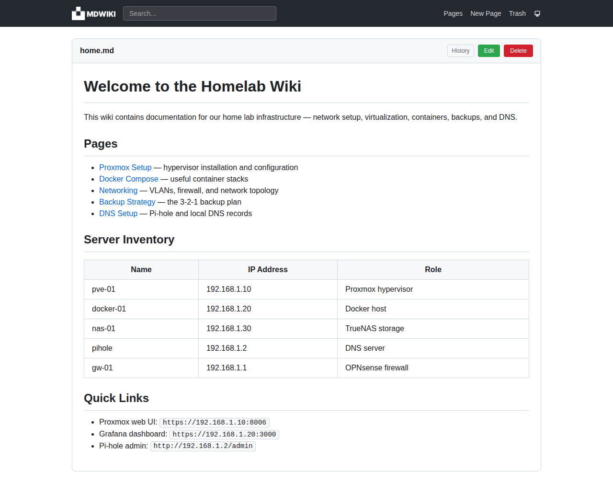
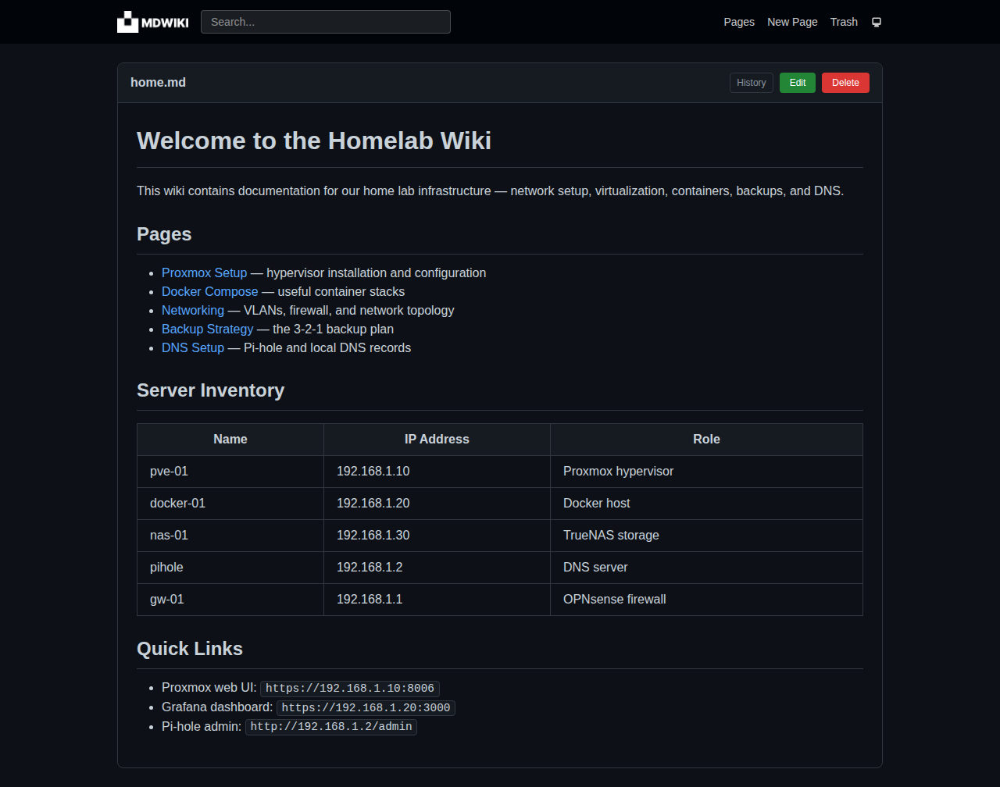

# mdwiki

Simple, self-contained markdown wiki written in Go. Single binary, no database, no user accounts.

## Screenshots

| Light mode | Dark mode |
|---|---|
|  |  |

## Why?

I built mdwiki to document my homelab while learning Linux, server, and network administration. I wanted something really simple and barebone - just markdown files on disk, no databases, no auth. Most wikis out there were way too heavy for what I needed.

It also doubled as a fun side project to work with Go and React, two technologies I enjoy. And honestly, building the wiki was a great form of procrastination.

## Features

- Single binary deployment (frontend embedded in Go binary)
- Pages stored as plain markdown files
- Page versioning (every save creates a new version)
- Trash with restore support
- Fuzzy search (instant results in navbar dropdown as you type)
- React SPA frontend with Tailwind CSS

## Tech Stack

- **Backend:** Go, [Echo](https://echo.labstack.com/) framework, `embed` for static assets
- **Frontend:** React, TypeScript, Vite, Tailwind CSS
- **Storage:** Plain markdown files on disk

## How to Build

Requires Go 1.25+ and Node.js.

```
make
```

This will install frontend dependencies, build the React SPA, and compile the Go binary with the frontend embedded.

## Development

```
make dev
```

This starts both the Vite dev server (with hot reload) and the Go backend (with [air](https://github.com/air-verse/air) for hot reload). Air is installed automatically if not present.

Open the **Vite dev server** address (default `http://localhost:5173`) in your browser. API requests are proxied to the Go backend automatically.

## Production

```
make
./mdwiki
```

The built binary serves everything — open the **Go backend** address (default `http://localhost:8080`, configured in `config.yml`).

Other targets:

```
make clean          # Remove build artifacts
make test           # Run Go tests
make dev-frontend   # Run Vite dev server only
make dev-backend    # Run Go server with air only
```

## Configuration

Application loads `config.yml` on startup.

```yaml
host: localhost
port: 8080
storage: .storage
```

- `host` & `port` - web server bind address
- `storage` - directory where pages are stored

## MCP Server

The wiki serves a Model Context Protocol (MCP) server at
`http://localhost:8080/mcp` using Streamable HTTP. It runs in the same binary
and shares storage with the web UI.

Available tools:

- `list_pages`, `read_page`, `search_pages`
- `create_page`, `update_page`, `rename_page`, `delete_page`
- `list_trash`, `read_trash_page`, `restore_page`
- `list_versions`, `read_version`, `restore_version`

Page names accept an optional `.md` extension. Create and update take
`filename` and `content` (complete Markdown); rename takes `filename` and
`newFilename`. Version tools take `version`, the exact `Filename` returned by
`list_versions`. Saves use the wiki's existing versioning; deletion moves pages
to trash. There is intentionally no permanent-delete tool. Conflicting creates,
renames, deletes, and restores refuse to overwrite existing pages.

Set `MCP_TOKEN` in the environment (recommended), or `mcp_token` in `config.yml`,
to require `Authorization: Bearer <token>` on every MCP request. If unset, MCP
is unauthenticated, like the existing REST API. Cross-origin browser requests
are rejected. This token protects **only `/mcp`**, not the web UI or REST API:
keep the wiki on localhost or a trusted network, or put the entire application
behind an authenticated HTTPS reverse proxy. Use HTTPS for remote token access.

Configure your MCP client's Streamable HTTP connection with the URL above and,
if configured, the Authorization header. For example, clients using an
`mcpServers` configuration may accept:

```json
{
  "mcpServers": {
    "mdwiki": {
      "url": "http://localhost:8080/mcp",
      "headers": { "Authorization": "Bearer YOUR_TOKEN" }
    }
  }
}
```

Exact configuration syntax varies by client. Clients can modify wiki content;
enable tool confirmations if you want to approve edits. Existing storage uses
second-resolution version timestamps, so multiple edits within one second can
overwrite that second's snapshot.

## Running as `systemd` Service

### Service file example

```ini
[Unit]
Description=mdwiki
After=network.target
Wants=network-online.target

[Service]
Restart=always
Type=simple
WorkingDirectory=/opt
ExecStart=/opt/mdwiki

[Install]
WantedBy=multi-user.target
```

- Update `ExecStart` and `WorkingDirectory` based on installation path
- Working directory must contain `config.yml`
- Place the file in `/etc/systemd/system/mdwiki.service`

### Running the service

- Start: `systemctl start mdwiki`
- Stop: `systemctl stop mdwiki`
- Status: `systemctl status mdwiki`
- Enable on boot: `systemctl enable mdwiki`
